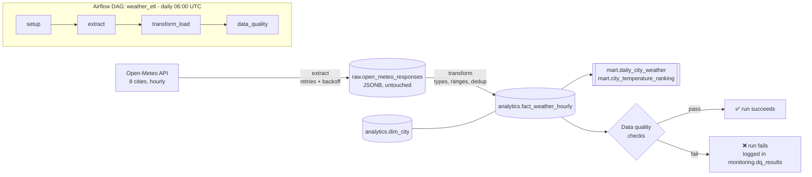

# 🌦️ Weather Batch ETL Pipeline


A production-style **daily batch pipeline** that pulls hourly weather data for 8 cities
(London, Berlin, Madrid, Paris, Amsterdam, Casablanca, Dubai, Toronto) from the free
[Open-Meteo API](https://open-meteo.com/), cleans it, loads it into a PostgreSQL warehouse
with a dimensional model, and **blocks bad data** with automated quality checks.
Orchestrated by **Apache Airflow 3**, fully containerised with **Docker**, tested in **CI**.

---

## Architecture



| Layer | Schema | Purpose |
|---|---|---|
| Raw (bronze) | `raw` | API responses stored as JSONB exactly as received, so any day can be re-processed without calling the API again |
| Analytics (silver) | `analytics` | Typed, validated star schema: `dim_city` + `fact_weather_hourly` (grain = city × hour) |
| Mart (gold) | `mart` | Business-ready views: daily min/max/avg per city, daily warmest-city ranking |
| Monitoring | `monitoring` | `pipeline_runs` (every step, status, row counts) and `dq_results` (every check, every run) |

## Engineering decisions

- **Idempotent loads.** The fact table's primary key is `(city_id, observed_at_utc)` and loads use
  `INSERT … ON CONFLICT DO UPDATE`. Re-running a day (Airflow retry, manual re-run, backfill) never
  creates duplicates, and it picks up corrected values from the source. Covered by tests.
- **Raw data kept separately.** Transform reads the latest raw payload from the warehouse, not from the API.
  Fixing a transform bug means re-running `transform_load`, not re-downloading data.
- **Retries at two levels.** HTTP calls retry with exponential backoff on timeouts, 429 and 5xx, but
  *not* on other 4xx (a bad request won't fix itself). Airflow retries each task 3× on top of that.
  The `data_quality` task has **0 retries**: bad data needs a human, not another attempt.
- **Quality gates.** Blocking checks (`error`) fail the run; soft checks (`warn`) are only logged:

  | Check | Severity | Rule |
  |---|---|---|
  | `row_count_per_city` | error | every city has exactly 24 hourly rows |
  | `no_null_temperature` | error | core metric is never null |
  | `no_duplicate_keys` | error | one row per city per hour |
  | `humidity_in_range` | error | 0–100 % |
  | `min_not_above_max` | error | sanity check on the mart aggregation |
  | `nulls_in_secondary_metrics` | warn | humidity / precipitation / wind may be missing |

- **Everything in UTC.** Data is requested and stored in UTC, which avoids daylight-saving bugs across
  8 timezones. Local time is a reporting concern.
- **Logic kept separate from the orchestrator.** Airflow tasks are thin wrappers around plain functions in
  `etl/pipeline.py`. The same code runs from the CLI, from tests, or from another orchestrator.
- **Automatic backfill routing.** Dates older than 60 days are automatically routed to Open-Meteo's archive API.

## Project structure

```
weather-etl-pipeline/
├── dags/weather_etl_dag.py      # Airflow DAG (TaskFlow API)
├── etl/
│   ├── config.py                # cities, API + DB settings
│   ├── extract.py               # API calls, retries, backoff
│   ├── transform.py             # cleaning, validation, dedup
│   ├── load.py                  # raw landing, upserts, run logging
│   ├── quality.py               # SQL data-quality checks
│   └── pipeline.py              # the 4 steps, orchestrator-agnostic
├── sql/schema.sql               # raw / analytics / mart / monitoring
├── scripts/run_pipeline.py      # run or backfill without Airflow
├── tests/                       # 21 tests: unit, integration (real Postgres), DAG integrity
├── .github/workflows/ci.yml     # lint + tests on every push
├── docker-compose.yml
└── Dockerfile
```

## Run it

**Requirements:** Docker Desktop.

```bash
git clone https://github.com/<your-username>/weather-etl-pipeline.git
cd weather-etl-pipeline
docker compose up -d --build        # or: make up
```

1. Open **http://localhost:8080**. The `weather_etl` DAG is already enabled (the local setup has no login).
2. Click ▶ **Trigger** to load yesterday's data. Each run loads the full day **before** its run time.
3. Look at the results:

```bash
docker compose exec warehouse psql -U etl -d weather     # or: make psql
```
```sql
SELECT * FROM mart.daily_city_weather ORDER BY day DESC, temp_avg_c DESC;
SELECT * FROM mart.city_temperature_ranking WHERE warmest_rank = 1;
SELECT run_date, check_name, passed FROM monitoring.dq_results ORDER BY check_id DESC LIMIT 12;
```

**Backfill a date range:**
```bash
# via Airflow
docker compose exec airflow airflow backfill create --dag-id weather_etl \
    --from-date 2026-09-01 --to-date 2026-09-07
# or without Airflow (against the dockerised warehouse)
pip install -r requirements.txt
WAREHOUSE_PORT=5433 python scripts/run_pipeline.py --start 2026-09-01 --end 2026-09-07
```

## Tests

```bash
pip install -r requirements-dev.txt
docker compose up -d warehouse
make test
```

- **Unit tests:** transform rules (range checks, nulls, dedup, day filtering) and extract retry behaviour (5xx, network errors, 400, give-up), using a fake HTTP session.
- **Integration tests:** the full pipeline against a real PostgreSQL. They cover idempotent re-runs, source corrections, a partial day failing the quality gate, and an extract failure being logged.
- **DAG tests:** the DAG imports cleanly, tasks run in the right order, retries are set as designed (these run when Airflow is installed).

CI runs lint and all tests against a Postgres service container on every push.

## What I'd add next

- Alerts on failure (Slack/email callback)
- dbt for the mart layer, with its own tests and docs
- Move the warehouse to BigQuery or Snowflake and store raw files in object storage (S3/GCS) as Parquet
- A small dashboard (Metabase / Streamlit) on top of the mart

---
*Data: [Open-Meteo](https://open-meteo.com/) (CC BY 4.0).*
